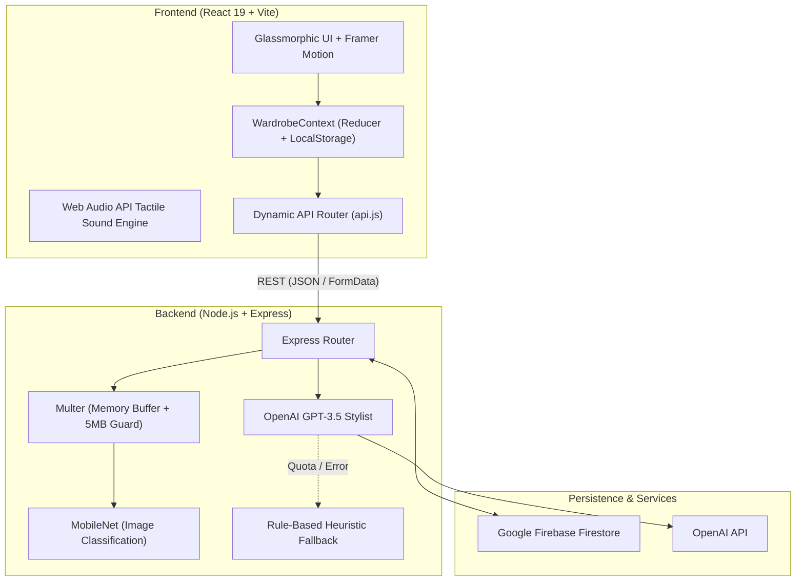

# 👗 WardrobeWhiz

> **"Where Fashion Meets Your Closet"**  
> *Crafted with passion by Shubh Sharma*

[](https://wardrobewhiz.vercel.app/home)
[](https://wardrobewhiz.onrender.com/api/health)
[](LICENSE)
[]()

WardrobeWhiz is a full-stack, AI-driven digital wardrobe assistant and personal styling application. It digitizes physical closets, classifies uploaded garments using computer vision, generates context-aware outfit recommendations using generative AI and color theory, and calculates data-driven wardrobe analytics—all wrapped in a warm, glassmorphic UI.

---

## 🌐 Live Demo & Repository

- **Live Application:** [https://wardrobewhiz.vercel.app/home](https://wardrobewhiz.vercel.app/home)
- **Backend Health Check:** [https://wardrobewhiz.onrender.com/api/health](https://wardrobewhiz.onrender.com/api/health)
- **GitHub Repository:** [https://github.com/shubh201203/wardrobewhiz](https://github.com/shubh201203/wardrobewhiz)

---

## 💡 The Problem & The Solution

- **The Problem:** The average person wears only 20% of their wardrobe 80% of the time. Garments are forgotten in physical closets, leading to decision fatigue, unnecessary repeat purchases, and difficulty putting together occasion-ready outfits.
- **The Solution:** WardrobeWhiz bridges the physical and digital closet. Users photograph their clothes; the system categorizes them using computer vision, syncs them to cloud persistence, and leverages generative AI to suggest stylish, harmonious outfit combinations based on what the user **actually owns**.

---

## ✨ Verified Features

### 1. 🏠 Today's Style (Daily Dashboard)
- Instant daily outfit briefing with match score and styling rationale.
- 1-click look shuffle across curated combinations.
- Real-time closet count, combination index, and dynamic versatility score.
- Quick action navigation pills for fast access to core workflows.

### 2. 🧥 Digital Closet & AI Image Classifier
- Multi-category view with instant client-side filtering (**Tops**, **Bottoms**, **Outerwear**, **Shoes**).
- Camera capture & file upload with backend **MobileNet** tensor classification for automated garment categorization.
- Real-time CRUD synchronization with **Firebase Firestore**.
- Responsive empty states and interactive `react-hot-toast` notifications.

### 3. ✨ Intelligent Outfit Generator
- Occasion-based styling engine (**Casual**, **College**, **Interview**, **Date Night**, **Party**).
- Color-theory and silhouette pairing logic based on wardrobe inventory.
- Framer Motion "AI Thinking" pulse animations for responsive processing feedback.
- Detailed outfit reasoning breakdown with match score progress indicators.

### 4. 💬 AI Chat Stylist
- Conversational fashion assistant powered by **OpenAI GPT-3.5 Turbo**.
- **Context Injection**: Transmits the user's active wardrobe inventory in the request payload so advice is tailored to clothing the user already owns.
- **Fault-Tolerant Heuristic Fallback**: Automatically falls back to local wardrobe-aware rule heuristics if the remote AI service experiences network latency or quota limits.

### 5. 📊 Data-Driven Style Analytics (Insights)
- Real-time category distribution counts (Tops, Bottoms, Outerwear, Shoes).
- Dynamic color palette mix tracker (Neutral vs. Accent distribution).
- Wardrobe Gap Detector alerting users to missing foundational items (e.g., lack of formal shoes or layering jackets).
- Calculated Closet Balance Score out of 100.

### 6. 🪞 AvatarFit Prototype (Virtual Fitting Room)
- Live webcam integration for interactive pose alignment and body proportions.
- Real-time video mirror with landmark overlay simulation (Proof-of-Concept).
- Graceful camera permission handling and unmount cleanup.

### 7. 🔐 Frictionless Authentication & Session Persistence
- `localStorage`-backed session preservation across browser reloads.
- **1-Click Demo Guest Access** for instant evaluator testing without manual registration.

---

## 🏗️ System Architecture



---

## 🛠️ Technology Stack

| Layer | Technology | Purpose |
| :--- | :--- | :--- |
| **Frontend Framework** | React 19, Vite 8 | High-performance SPA with fast module reloading |
| **Routing** | React Router DOM v7 | Nested layout routes with SPA fallback configuration |
| **Animations & UI** | Framer Motion, Lucide Icons | Fluid layout transitions, spring physics, glassmorphism |
| **Notifications** | React Hot Toast | Lightweight toast notifications |
| **Audio** | HTML5 Web Audio API | Synthesized haptic tap feedback without external assets |
| **Backend Runtime** | Node.js (ES Modules), Express | Modular RESTful API engine |
| **File Handling** | Multer | Guarded memory buffers with 5MB limits and MIME filters |
| **Machine Learning** | MobileNet (`@tensorflow/tfjs-node`) | Automated garment classification |
| **Generative AI** | OpenAI API (`gpt-3.5-turbo`) | Context-aware personal fashion stylist |
| **Cloud Database** | Firebase Firestore (Admin SDK) | Document persistence for users and wardrobe items |
| **Testing** | Node.js Native Test Runner (`node:test`) | Fast, zero-dependency unit testing |
| **Deployment** | Vercel (Frontend), Render (Backend) | Globally distributed production hosting |

---

## 🚀 Local Development Setup

### Prerequisites
- **Node.js** >= 18.0.0
- **npm** >= 9.0.0

### Step 1: Clone the Repository
```bash
git clone https://github.com/shubh201203/wardrobewhiz.git
cd wardrobewhiz
```

### Step 2: Configure Environment Variables

**Backend Configuration (`server/.env`):**
```env
PORT=5000
OPENAI_API_KEY=your_openai_api_key_here
# Optional for deployment: serialized service account JSON
# FIREBASE_SERVICE_ACCOUNT={"type": "service_account", ...}
```

**Firebase Credentials (`server/serviceAccountKey.json`):**
Download your private key from the Firebase Console (Project Settings > Service Accounts) and place it at:
```text
server/serviceAccountKey.json
```
*(A mock database fallback activates automatically if credentials are not present).*

### Step 3: Install Dependencies

```bash
# Install backend dependencies
cd server
npm install

# Install frontend dependencies
cd ../client
npm install
```

### Step 4: Run the Application

In **Terminal 1** (Backend):
```bash
cd server
npm start
```
*Expected: `Server running on port 5000`*

In **Terminal 2** (Frontend):
```bash
cd client
npm run dev
```
*Expected: `Local: http://localhost:5173/`*

Open `http://localhost:5173` in your browser. The frontend dynamically connects to `http://localhost:5000` when running locally and falls back to production when hosted.

---

## 🧪 Testing & Quality Assurance

Run the automated test suite:
```bash
# From client or server directory:
npm test
```

Run ESLint checks:
```bash
cd client
npm run lint
```

Build verification:
```bash
cd client
npm run build
```

---

## 📡 API Endpoint Reference

| Method | Endpoint | Description | Payload / Response |
| :--- | :--- | :--- | :--- |
| `GET` | `/api/health` | Service health status check | `{"status": "OK", "message": "WardrobeWhiz Engine is online 🚀"}` |
| `POST` | `/api/upload` | Classifies apparel from image | Multipart `image` file (Max 5MB) → `{predictions: [...]}` |
| `POST` | `/api/chat` | AI styling advice with closet context | `{query: string, wardrobeContext: [...]}` → `{reply: string}` |
| `GET` | `/api/wardrobe` | Fetches user's saved items | `[...]` |
| `POST` | `/api/wardrobe` | Adds item to Firestore | `{name, category, color, type, image}` → `{id, ...}` |
| `DELETE` | `/api/wardrobe/:id`| Deletes item from Firestore | `{success: true, message: string}` |

---

## 🔒 Security & Data Isolation Notice

- **Secret Protection:** `.env` files, API keys, and Firebase Admin service-account credentials are strictly ignored in `.gitignore` and never committed to version control.
- **Upload Guard:** Image uploads are guarded with a 5MB memory limit and MIME-type filtering to prevent denial-of-service/OOM vulnerabilities.
- **Tenant Isolation Note:** The current MVP operates on a shared sandbox collection (`demo_user`) to facilitate evaluation without mandatory sign-up friction. Production roadmap includes Firebase Authentication JWT verification on API routes to enforce strict multi-tenant collection isolation.

---

## 🔮 Known Limitations & Future Roadmap

1. **AvatarFit Virtual Fitting:** The current AvatarFit module is a camera-based body mapping prototype that previews garment silhouettes over live video feeds. Full real-time 3D physics-based mesh deformation is slated for future development with WebGL/Three.js.
2. **User Isolation:** Upgrade the backend from the shared demo tenant to verified Firebase Auth user UID claims.
3. **Offline Sync:** Add IndexedDB caching with Service Workers for offline catalog access.

---

## 👨‍💻 Author

**Shubh Sharma**  
- **Portfolio:** [https://shubh201203.github.io/portfolio/](https://shubh201203.github.io/portfolio/)  
- **GitHub:** [@shubh201203](https://github.com/shubh201203)  
- **Live Demo:** [https://wardrobewhiz.vercel.app/home](https://wardrobewhiz.vercel.app/home)
